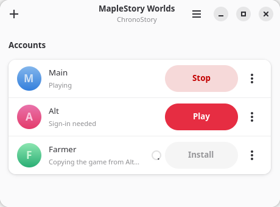

# MapleStory Worlds Wine Launcher

An unofficial launcher for playing MapleStory Worlds on Linux through Wine, with
several accounts side by side. Add your accounts once, sign in to each one once,
and from then on each account starts your world with a single **Play** button.
It downloads the official Windows client, sets up the components it needs, and
handles updates.



You'll need 64-bit Linux, Wine, Python 3.11 or newer, PyGObject with GTK 4,
libadwaita and WebKitGTK 6.0, and `xdg-utils`. Your graphics driver needs Vulkan 1.4
support for DXVK. Allow at least 6 GiB of free space for the first account.

- Arch: `wine python-gobject gtk4 libadwaita webkitgtk-6.0 xdg-utils`
- Debian/Ubuntu: `wine python3-gi gir1.2-gtk-4.0 gir1.2-adw-1 gir1.2-webkit-6.0 xdg-utils`

Open a terminal in this folder and run:

```sh
./msw
```

## Using it

1. Click **+** (or **Add account**), give the account a name such as Main, and
   paste the page link of the world it should play.
2. A Nexon sign-in window opens. Sign in to that account and tick
   **Login automatically in the future** so it stays signed in. Meanwhile the
   launcher installs the game for that account.
3. Press **Play**. The launcher opens that account's world as that
   account and starts the game.

Add more accounts the same way. Each account has its **own game install, Wine
prefix and Nexon sign-in**, so several can play at the same time without
interfering with each other. A new account copies the game from an existing one
rather than downloading it again (close that account's game first); each account
uses about 5 GB.

While an account is playing, its button turns into **Stop**. The **⋮** menu on
each account has Sign in again, Sign out, Update / repair game, Wine settings,
Show log, **Change world…**, Rename and Remove. Each account has its own world,
chosen when you add it (or the first time you press Play): paste the link of any
world page from maplestoryworlds.nexon.com. The main menu registers the desktop
menu entry.

### How Play works

The Worlds website starts the game by building a launch link from your signed-in
browser session. Each account in the launcher has its own private browser
profile: Play opens your world's page in that profile, lets the site's own Play
button build the link, and hands the link straight to that account's game
instead of to your normal browser. If the account isn't signed in, the same
window shows Nexon's real sign-in page. Your password is entered only into
Nexon's page; the launcher never sees or stores it.

The game's built-in **LOG IN** button doesn't work under Wine (Toy SDK error
`803020007`), which is why sign-in goes through the website. See the
[validation notes](docs/validation.md#login-and-per-account-sessions).

## Desktop integration

The first install adds **MapleStory Worlds** to your application menu. It opens
the launcher, and running game windows group under the same icon, so you can pin
it to your taskbar. It also registers the `ngm://` handler, so pressing Play on
the website in your own browser still works — those launches go to the first
account. After pulling an update to this repo, use **Register website links**
in the menu (or `./msw register-desktop`) to update the installed copy.

## Command line

```sh
./msw                          # Open the launcher
./msw --account alt stop       # Close an account's game and its background processes
./msw --account alt update     # Update or repair an account's game files
./msw --account alt doctor     # Show an account's paths and installation status
./msw --account alt uninstall  # Delete an account's game and prefix, with confirmation
```

`--account` takes an account's name or id. `./msw --help` lists everything.
Playing through the launcher is the reliable path; `./msw play` opens the client
without a sign-in, which hits the broken in-game login.

When the game accepts Quit, the launcher gives it five seconds to finish, then
stops its remaining game, browser, and Wine processes. Closing the game window
still requires confirming the game's Quit dialog. Vuplex can still show an error
during quit; see the
[validation notes](docs/validation.md#recurrent-quit-crash-symbolized-evidence).

## Files

The account list and chosen world live in `~/.config/msw-helper-wine/accounts.json`.
An install from before multi-account support (in `~/.local/share/msw-helper-wine`)
appears as the **Default** account; added accounts are stored under
`~/.local/share/msw-helper-wine/instances/`. Each account folder holds its Wine
prefix, logs, and its private Nexon sign-in profile (`web/`). **Remove…** →
**Delete everything** deletes an account's folder contents; no `sudo` is needed.

If something goes wrong, **Show log** in an account's menu shows what happened,
and `./msw --account <name> doctor` reports the installation's status. The
[testing notes](docs/validation.md) cover the Wine setup and issues we've seen.

Launcher source: [GPL-3.0-or-later](LICENSE). MapleStory Worlds and its artwork
belong to their respective owners. This project is not affiliated with Nexon.
