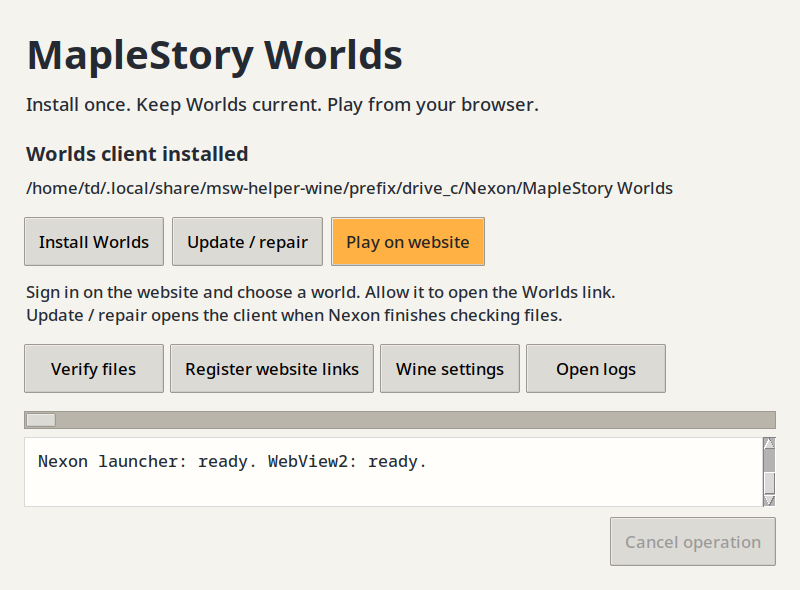

# MapleStory Worlds Wine Helper

Install the **actual MapleStory Worlds Windows client**, update/repair it with
Nexon's patcher, and open website `ngm://` links in the same Wine prefix. Includes
a Python/Tk desktop GUI and a command line interface.

The installer downloads Nexon's unmodified game files. A completed installation
contains `msw.exe`, `UnityPlayer.dll`, `GameAssembly.dll`, `msw_Data/`, and the Nexon
patch manifest. Installing only Nexon Game Manager never counts as success.



## Quick start

Requirements: Linux x86-64, Python **3.11+**, Python Tk, Wine with 64-bit Windows
and 32-bit installer support, a graphical desktop, and `xdg-utils`. Allow at least
6 GiB free for installation. Graphics need a current Vulkan driver compatible
with [DXVK 3.x](https://github.com/doitsujin/dxvk/wiki/Driver-support) (normally
Vulkan 1.4). A current Wine Staging build is a suitable starting
point; see [validation](docs/validation.md) for the version actually tested.

```sh
# Graphical installer
./msw

# Or install everything, including desktop integration
./install.sh

# Check installed files
./msw verify

# Check for updates and repair files (Nexon opens the client afterward)
./msw update

# Sign in and select a world in your normal Linux browser
./msw play
```

Tk is packaged as `tk` on Arch Linux and `python3-tk` on Debian/Ubuntu. Wine and
desktop dependencies should be installed using your distribution's package
manager. The helper uses your installed Wine and does not change system packages.

## Website launch

Installation registers **MapleStory Worlds (Wine)** in your application menu and
makes the helper the handler for `ngm://` links. Sign in on the
[official Worlds website](https://maplestoryworlds.nexon.com/en/play), choose a
world, and allow the browser to open the external application.

The complete URL is passed as **one argument**, without decoding/re-encoding it,
splitting it at spaces, or sending it through a shell. Nexon handles the session
ticket, patching, and world selection. Login stays in your browser. Expired login
links must be generated again by clicking Play on the website.

```sh
# Re-register after moving/updating the helper, or changing Wine/data directories
./msw register-desktop

# Inspect the desktop association
xdg-mime query default x-scheme-handler/ngm
# Expected: msw-helper-wine-ngm.desktop
```

The `ngm` scheme is shared by Nexon games. This helper claims that desktop
association and accepts Worlds game code `106603`; it rejects other Nexon games.
If your browser continues to show Nexon's installer prompt after opening the
client, check its external-application and local-network permission settings.

## Paths and options

Default data directory: `$XDG_DATA_HOME/msw-helper-wine`, normally
`~/.local/share/msw-helper-wine`. `MSW_HOME` overrides it. It contains:

| Path | Contents |
| --- | --- |
| `prefix/` | Dedicated Wine prefix |
| `prefix/drive_c/Nexon/MapleStory Worlds/` | Actual Worlds binaries and game data |
| `cache/` | Publisher downloads, reusable after an interrupted install |
| `logs/helper.log` | Wine/NGM output with launch arguments redacted |
| `logs/webview-bootstrap.log` | Microsoft runtime bootstrap diagnostics |
| `state.json` | Last verified operation and installed patch-manifest hash |
| `dxvk.json` | Installed graphics version and DLL integrity hashes |
| `helper/` | Copy used by desktop entries, independent of the checkout location |

```sh
# Use another Wine build and/or data directory consistently for every command
./msw --wine /path/to/wine --data-dir "$HOME/Games/Worlds" install
./msw --wine /path/to/wine --data-dir "$HOME/Games/Worlds" gui

# Repository-local installation, useful for development
./msw --data-dir "$PWD/runtime" install --no-desktop

./msw doctor
./msw winecfg
./msw --help
```

`MSW_WINE` selects a Wine executable. The helper deliberately ignores a foreign
`WINEPREFIX` and `WINEARCH`; it consistently uses its own prefix. It preserves
your display and audio environment. On desktops with `DISPLAY`, Wine uses X11
(or XWayland). The helper installs **DXVK 3.1** for Direct3D 11 and DXGI in this
prefix, enabled specifically for `msw.exe` and `Vuplex WebView.vuplex`. Nexon's
launcher and security processes retain Wine's builtin graphics configuration.
The archive is pinned to the SHA-256 published with the upstream release;
installed DLLs are also checked before launching. DXVK logs go in `logs/`.
The bundled Vuplex browser uses Wine's Windows 7 compatibility mode; the game
continues to use Windows 10.

## Installation and updates

1. Initialize a Wine prefix, suppressing optional Mono/Gecko first-run prompts.
2. Install Microsoft's official x64 WebView2 runtime. When the Edge updater
   stalls, stage its official inner installer, validate it against the bundled
   Microsoft SHA-256 manifest, and run it directly. Set the WebView2 process to
   Wine's Windows 7 compatibility mode while the game uses Windows 10.
3. Fetch Nexon's current NGM component metadata and bootstrap the 64-bit launcher.
   Legacy HTTP URLs are upgraded to HTTPS. Nexon's `crc` values identify component
   revisions; cached files are additionally checked with local SHA-256 hashes.
4. Ask NGM to install Worlds (`106603@1585`). NGM owns content download, patching,
   and its required game dependencies. Before invoking NGM, the helper installs
   DXVK 3.1 so Worlds and its Vuplex browser can share Direct3D textures.
5. Check the real client files and patch manifest, then repair the executable
   registration under `HKCU\Software\Nexon\MOD` and install desktop integration.

`update` uses NGM's **restore** flow, which checks/repairs game content and opens
the client afterward. Website launches also use NGM so Nexon can patch before
launching. `verify` checks the core binaries/data and completion manifest; it is
not a replacement for Nexon's full content verification.

Close Worlds and Nexon's launcher before installing or updating. A per-prefix
lock prevents concurrent helper operations. Downloads use temporary files and
atomic replacement. Failed operations do not write a success state. Cancellation
stops the helper's current process; Nexon may already have spawned a separate
window. Close that window before retrying. The helper never kills an entire Wine
server or a newly launched game during normal operation.

## Troubleshooting

- **Security-module reset error 201 when entering a world:** close every Worlds
  instance, including development/test copies, and launch again from the website.
  This is a separate world-entry check; passing `verify` does not validate the
  security session. A reported regression and the current investigation are
  recorded in [validation](docs/validation.md#world-entry-regression-security-error-201).
- **Repeated “Vuplex WebView.vuplex” / Wine Debugger windows:** close Worlds and
  launch it from the website again using the updated helper, or run Update /
  repair. The handler automatically installs DXVK 3.1 before launching. WineD3D
  fails Vuplex's `OpenSharedResource` call, and older DXVK 2.x builds do not support
  the current upstream Wine sharing path. This fixes the reproduced graphics
  failure; the helper does not disable Wine's crash reporting.
- **Missing game files:** rerun Install, or use Update / repair for an existing
  game directory. Do not use NGM's presence as proof the game is installed.
- **White/blank Nexon window:** check `./msw doctor` for WebView2, retry Install,
  and use a current Wine build. The helper supplies WebView2's Wine compatibility
  setting and disables GPU rendering for that embedded browser only.
- **Website asks to install NGM:** rerun `register-desktop`, check the browser's
  permission to open external apps, and click Play again after setup completes.
- **Expired session/empty client:** sign in on the website and launch a world
  there. A client started by repair has no authenticated website ticket.
- **Failure diagnostics:** `./msw doctor` prints paths without storing website
  tickets. The helper log redacts launch arguments; Nexon's own logs inside the
  prefix can contain them, so remove them before sharing those logs.

The project targets the current global Worlds Windows launch flow. Wine support
and authenticated gameplay depend on Nexon's current client/service. The tested
and untested parts are recorded in [docs/validation.md](docs/validation.md).

## Development

No pip dependencies are required.

```sh
python3 -m unittest discover -s tests -v
PYTHONPATH=. python3 tests/gui_smoke.py
PYTHONPATH=. python3 tests/desktop_smoke.py  # requires gio + desktop-file-validate
# In a headless CI environment:
PYTHONPATH=. xvfb-run -a python3 tests/gui_smoke.py
```

The tests cover incomplete installs, repair, failed update detection, download
truncation and checksums, graphics migration, locking, protocol preservation, token redaction, and real Tk event
delivery. They do not download a game or require a Nexon account.

Inspired by the approach in the author's `pso_wine` project. Publisher endpoints
and launch parameters were checked against the
[Worlds website](https://maplestoryworlds.nexon.com/en/play),
[Nexon NGM protocol implementation](https://platform.nexon.com/ngm/js/npf_ngm.js),
[Worlds game metadata](https://ngmapi.nexon.com/game-info/106603), and
[NGM component metadata](https://platform.nexon.com/NGM/Json/NGMUpdateInfo.json).
Microsoft documents the [WebView2 distribution flow](https://learn.microsoft.com/en-us/microsoft-edge/webview2/concepts/distribution).

Helper source is licensed under GPL-3.0-or-later. Nexon game files, Microsoft
runtimes, and other downloaded components remain under their respective licenses
and are excluded from this Git repository.
